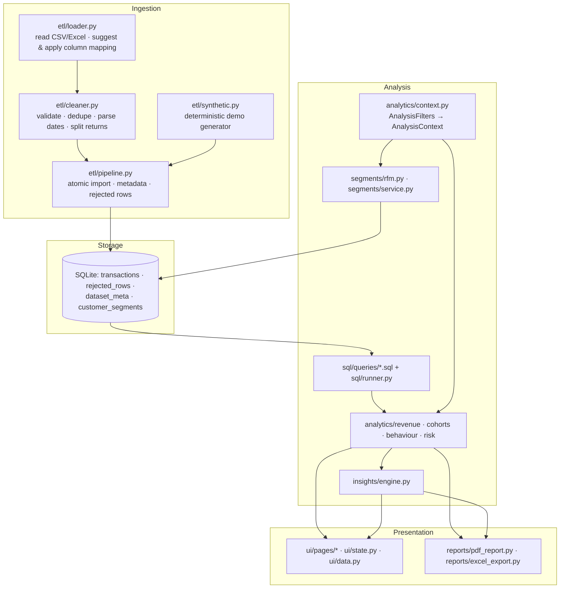

# Architecture

CustomerIQ is a single-process Streamlit application backed by a local SQLite database. The design keeps **analysis in SQL**, **rules in configuration** and **presentation in the UI layer**, so every number on screen can be traced to one documented query.

## Layered view

## Modules

| Package | Responsibility |
|---|---|
| `src/config.py` | Every analytical threshold: RFM segment rules and scoring thresholds, inactivity thresholds, cleaning options. These are frozen dataclasses, so they are hashable for caching and cannot be mutated by accident. |
| `src/database/` | `schema.sql` (tables and indexes) and `connection.py` (connection factory, schema initialisation, dataset metadata, `data_version`). |
| `src/etl/` | `loader` reads files (CSV delimiter and encoding sniffing, Excel) and maps arbitrary headers to the standard schema. `cleaner` applies validation rules and records a reason for every rejected row. `pipeline` writes a cleaned dataset atomically in one transaction. `synthetic` generates the labelled demo dataset. |
| `src/sql/` | 24 `.sql` files, each with a documented header, plus `runner.py`. The runner loads the files, expands the two filter macros (`{{FILTERED_TX}}`, `{{HISTORY_TX}}`) and binds parameters. |
| `src/segments/` | `rfm.py` builds the RFM SQL from validated configuration and materialises the results into `customer_segments` under a `run_key`. `service.py` gives segment-level queries to the UI. |
| `src/analytics/` | Thin Python functions that run a query and add presentation-friendly columns or reshape results. The cohort matrix pivot and the average retention curve live here. `context.py` defines the filter object and the per-request context. |
| `src/insights/` | Nine documented rules that turn analytics output into findings, each with a minimum-sample guard. |
| `src/reports/` | ReportLab PDF (vector charts, page numbers, 8 sections) and OpenPyXL workbook. |
| `src/ui/` | `state.py` (sidebar filters, session state, first-run bootstrap), `data.py` (cached access to analytics functions), `theme.py` (CSS and palette), `components.py` (cards, notes, formatting) and one module per page in `pages/`. |

## Request flow

1. `app.py` sets up the page, applies the theme, initialises state and builds `AnalysisFilters` from the sidebar (dates, segments, RFM and risk configuration).
2. A page calls `data.get("<function>", filters)`. The call is cached on `(function, dataset version, filters)`, so a new import or any filter change produces fresh results.
3. On a cache miss, `prepare_context` validates configuration and calls `materialize_segments`. This runs the RFM SQL once per `(dataset version, snapshot date, RFM config)` and stores it in `customer_segments`. The returned `run_key` lets every other query join to the same segment snapshot.
4. The analytics function executes its SQL file with `ctx.params()`. Dates, segment lists and thresholds are bound as parameters. The segment filter is passed as a JSON array and expanded with `json_each`.
5. The page renders Plotly charts and tables. Insights and reports reuse the same analytics functions, so the dashboard, PDF and Excel outputs always agree.

## Design decisions

- **SQL as the analytical engine.** Metrics are defined once, in SQL, and reused by the UI, insights, PDF, Excel and tests. Python never re-derives a metric that SQL already computes.
- **Returns in the same table.** Sales and returns share `transactions`, flagged by `is_return`, with negative revenue for returns. Net revenue is then simply `SUM(revenue)`, while "orders" count only sales invoices.
- **Materialised segments.** RFM uses window functions over the full customer base. Materialising it once per snapshot keeps the other queries fast and guarantees that every page uses identical segment assignments. Old runs are pruned automatically.
- **History vs period.** `{{HISTORY_TX}}` (all data up to the end date) is used wherever customer history matters: recency, first purchase, cohorts, risk. `{{FILTERED_TX}}` (inside the date range) is used for period metrics. This stops the date filter from silently reclassifying customers, for example turning an old customer into a "new" one.
- **No string-formatted user input in SQL.** All user values are bound. The only generated SQL is the RFM scoring expressions, which are built from validated numeric configuration.
- **Atomic imports.** A failed import leaves the previous dataset untouched.
- **Synthetic data is labelled at the source.** `dataset_meta.is_synthetic` drives the badges, banners and report notices.
