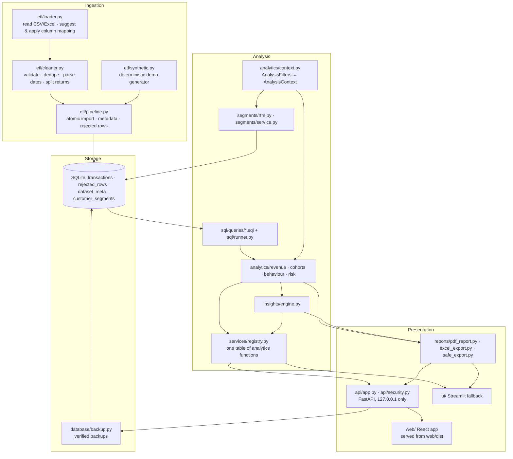

# Architecture

CustomerIQ is a local, single-user application backed by one SQLite database. A FastAPI server (`src/api`) exposes the analytics as a JSON API and serves the built React app (`web/`) from the same origin. The original Streamlit app (`app.py`, `src/ui`) remains as a fallback. Both front ends call the same Python analytics through `src/services/registry.py`, so they show the same numbers.

The design keeps **analysis in SQL**, **rules in configuration** and **presentation in the UI layer**, so every number on screen can be traced to one documented query.

## Layered view

## Modules

| Package | Responsibility |
|---|---|
| `src/config.py` | Every analytical threshold: RFM segment rules and scoring thresholds, inactivity thresholds, cleaning options. These are frozen dataclasses, so they are hashable for caching and cannot be mutated by accident. Also the database path (`CUSTOMERIQ_DB`, default `data/customeriq.db`). |
| `src/database/` | `schema.sql` (tables and indexes), `connection.py` (connection factory in WAL mode, schema initialisation, dataset metadata, `data_version`) and `backup.py` (verified backups). |
| `src/etl/` | `loader` reads files (CSV delimiter and encoding sniffing, Excel with a decompression-size check) and maps arbitrary headers to the standard schema. `cleaner` applies validation rules and records a reason for every rejected row. `pipeline` writes a cleaned dataset atomically in one transaction. `synthetic` generates the labelled demo dataset. |
| `src/sql/` | 24 `.sql` files, each with a documented header, plus `runner.py`. The runner loads the files, expands the two filter macros (`{{FILTERED_TX}}`, `{{HISTORY_TX}}`) and binds parameters. |
| `src/segments/` | `rfm.py` builds the RFM SQL from validated configuration and materialises the results into `customer_segments` under a `run_key`. `service.py` gives segment-level queries to the UI. |
| `src/analytics/` | Thin Python functions that run a query and add presentation-friendly columns or reshape results. The cohort matrix pivot and the average retention curve live here. `context.py` defines the filter object and the per-request context. |
| `src/insights/` | Nine documented rules that turn analytics output into findings, each with a minimum-sample guard. |
| `src/services/` | `registry.py`: the Streamlit-independent table of analytics functions that both the API and Streamlit call. |
| `src/reports/` | ReportLab PDF (vector charts, page numbers, 8 sections), OpenPyXL workbook, and `safe_export.py`, which escapes formula-like cells in CSV and Excel output. |
| `src/api/` | `app.py` (`create_app`: routes, response cache, write lock, backups before writes, serving `web/dist`), `security.py` (sessions, CSRF, bearer token, Host allowlist, security headers, body limits), `schemas.py` (strict request models) and `__main__.py` (the `python -m src.api` launcher). |
| `web/` | React + TypeScript app built with Vite. `src/api/` is the typed same-origin client and session handling, `src/pages/` has one module per page, `src/components/` holds the shared UI and the 2D SVG charts, and `src/scene/` holds the optional three.js scenes, which load only in 3D mode. |
| `src/ui/` | Streamlit fallback: `state.py` (sidebar filters, session state, first-run demo bootstrap), `data.py` (cached access to the registry), `theme.py`, `components.py` and one module per page in `pages/`. |

## Running modes

| Mode | Command | Browser address |
|---|---|---|
| Production | `npm run build` in `web/`, then `python -m src.api` | `http://127.0.0.1:8520/`: the API serves the page, its assets and `/api` |
| Development | `python -m src.api` and `npm run dev` in `web/` | `http://127.0.0.1:5173/`: Vite serves the page and proxies `/api` to the API |
| Fallback | `python -m streamlit run app.py --server.port 8517` | `http://localhost:8517/` |

In production the API registers the React app after every `/api` route. `/assets` and `/fonts` are static mounts. Any other path without a file extension returns `index.html`, so client-side routes such as `/segments` work on reload. Unknown `/api/...` paths and missing files stay JSON 404s, never the page. If `web/dist/index.html` is missing, the server runs the API alone.

## Request flow (web app)

1. The browser loads the page from the API (or from Vite in development). Every data request goes to `/api` on the same origin, so no CORS is needed and no API address appears in frontend code.
2. Each page sends its filters to `POST /api/analytics/batch` (or `/api/analytics/{name}`). The API validates them with strict Pydantic models and builds `AnalysisFilters`.
3. Results are cached in memory on `(data_version, analysis, filters, arguments)`, keeping the 256 most recent entries. A new import changes `data_version`, so stale results are never served.
4. On a cache miss, `prepare_context` validates configuration and calls `materialize_segments`. This runs the RFM SQL once per `(dataset version, snapshot date, RFM config)` and stores it in `customer_segments`. The returned `run_key` lets every other query join to the same segment snapshot.
5. The analytics function executes its SQL file with `ctx.params()`. Dates, segment lists and thresholds are bound as parameters. The segment filter is passed as a JSON array and expanded with `json_each`.
6. The page draws 2D SVG charts and tables (or a three.js scene in 3D mode). Insights, reports and CSV exports reuse the same registry functions, so the page, PDF, Excel and CSV always agree.

Writes (`/api/import/commit`, `/api/dataset/demo`, `/api/dataset/clear`) run one at a time under a lock. Each first takes a verified backup and refuses the change if the backup fails. Imports are two steps: `/api/import/preview` parses the upload and returns the suggested mapping and a validation summary, keeping the parsed file in memory for 30 minutes (at most 3 pending uploads); `/api/import/commit` applies the confirmed mapping.

The Streamlit fallback follows the same steps 4–6 in-process, with its own cache keyed on the dataset version and filters.

## Security model

The app is for one person on one machine. The model assumes the threat is other websites open in the same browser, not other local users.

- **Loopback only.** The server binds to `127.0.0.1` with no option to change it. `TrustedHostMiddleware` accepts only `127.0.0.1` and `localhost` Host headers (against DNS rebinding).
- **Browser sign-in.** The launcher prints a single-use login link (valid 10 minutes). Opening it sets an `HttpOnly`, `SameSite=Strict`, `Path=/api` session cookie (valid 12 hours) that page scripts cannot read. Sessions and login codes are kept in server memory only, so a restart signs everyone out.
- **CSRF.** Every non-GET browser request must carry the session's CSRF token (`X-CSRF-Token`, from `GET /api/session`, held in page memory only), an allowed `Origin`, and `Sec-Fetch-Site: same-origin` when the browser sends it. Allowed origins are the API's own port and the configured Vite port (`--web-port`).
- **Script access.** Local scripts may send `Authorization: Bearer <token>`. The token comes from `CUSTOMERIQ_API_TOKEN` or the git-ignored `.customeriq_token`, created on first run. The API refuses it from browsers, and it is never printed. `python -m src.api login-link` uses it to request a new login code.
- **Surface.** No CORS, no OpenAPI schema, no interactive docs and no debug routes. Errors are generic and never include paths or submitted values. API responses send `Content-Security-Policy: default-src 'none'`. The HTML page gets a CSP that allows only its own scripts, styles, fonts and connections.
- **SQL.** Only the 24 library files can run, with bound parameters, under `PRAGMA query_only`, capped at 5,000 rows. Query text is not returned by the API.
- **Uploads.** Request bodies are size-limited while streaming, and Excel files are checked for decompression bombs before parsing.

## Design decisions

- **SQL as the analytical engine.** Metrics are defined once, in SQL, and reused by both front ends, insights, PDF, Excel and tests. Python never re-derives a metric that SQL already computes.
- **One registry for two front ends.** The API and Streamlit call the same `services/registry.py` functions, so moving between them never changes a number.
- **Same-origin serving.** In production one process serves the page and the API. No CORS configuration exists to get wrong, and the session cookie never crosses origins.
- **Returns in the same table.** Sales and returns share `transactions`, flagged by `is_return`, with negative revenue for returns. Net revenue is then simply `SUM(revenue)`, while "orders" count only sales invoices.
- **Materialised segments.** RFM uses window functions over the full customer base. Materialising it once per snapshot keeps the other queries fast and guarantees that every page uses identical segment assignments. Old runs are pruned automatically.
- **History vs period.** `{{HISTORY_TX}}` (all data up to the end date) is used wherever customer history matters: recency, first purchase, cohorts, risk. `{{FILTERED_TX}}` (inside the date range) is used for period metrics. This stops the date filter from silently reclassifying customers, for example turning an old customer into a "new" one.
- **No string-formatted user input in SQL.** All user values are bound. The only generated SQL is the RFM scoring expressions, which are built from validated numeric configuration.
- **Atomic imports, verified backups.** A failed import leaves the previous dataset untouched. Before any API write, `backup_database` copies the database with SQLite's online backup API, checks `PRAGMA integrity_check` and every table's row count, and keeps the 10 newest automatic backups in `backups/`.
- **Optional 3D.** Standard mode uses lightweight 2D SVG charts. three.js and its scenes are split into a separate chunk that loads only when 3D mode is turned on.
- **Synthetic data is labelled at the source.** `dataset_meta.is_synthetic` drives the badges, banners and report notices.
