# CustomerIQ

**Customer revenue, retention and behaviour analytics for online sellers.** Import a sales file, then see who your best customers are, who is drifting away and where the revenue comes from.

**Live demo:** <https://customeriq-demo-1r3k.onrender.com> (read-only, synthetic data; the free host can take up to a minute to wake up)

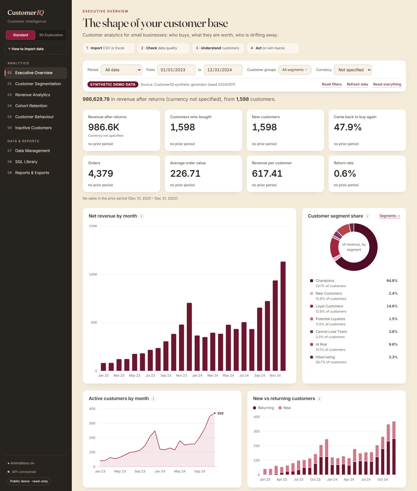

> The demo dataset is **synthetic** (seed `20240101`) and is labelled as such on every page and export.

## Features

| | |
|---|---|
| **Import** | CSV / Excel, automatic column mapping, validation, returns handling, rejected-row audit, verified backup before every change |
| **Overview** | 8 KPIs vs the previous period, trends, rule-based findings |
| **Segments** | Configurable RFM scoring, 7 segments, R×F grid, customer drill-down |
| **Cohorts** | Monthly retention heatmap and curve |
| **Revenue** | Trend, Pareto concentration, products, categories, countries |
| **Behaviour** | Purchase frequency, gaps, order values, weekday × hour |
| **Inactive** | Active / Cooling / At Risk / Lapsed, overdue flags, win-back list |
| **SQL Library** | 24 documented read-only queries, run with the current filters |
| **Exports** | PDF report, Excel workbook, formula-safe CSV |

## Standard

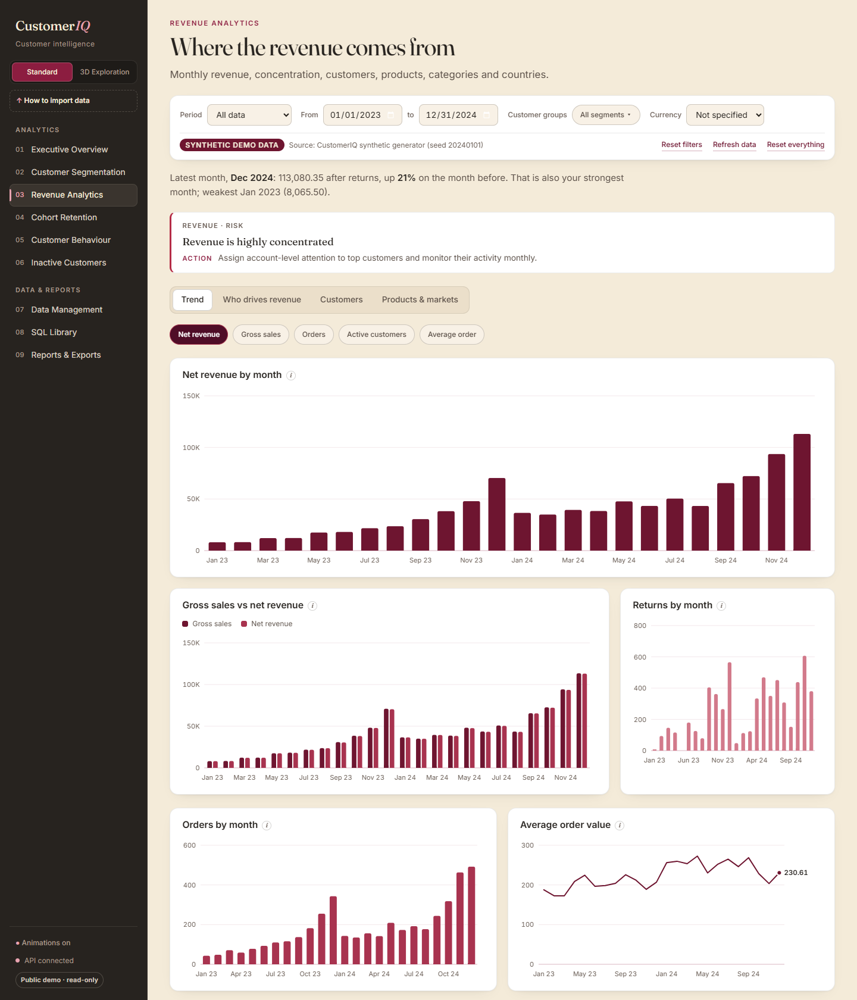

| Cohort Retention | Customer Behaviour |
|---|---|
| 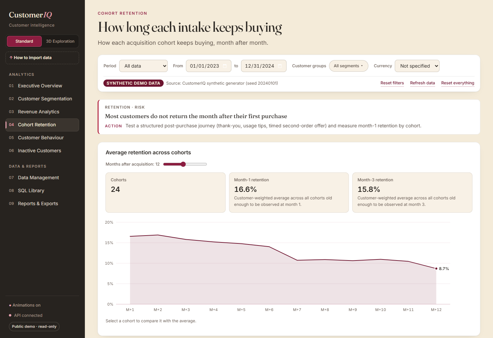 | 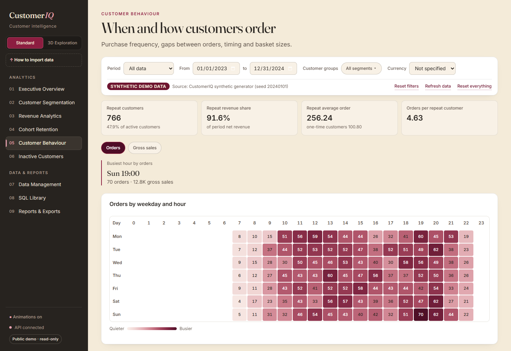 |

## 3D Exploration

| | |
|---|---|
| 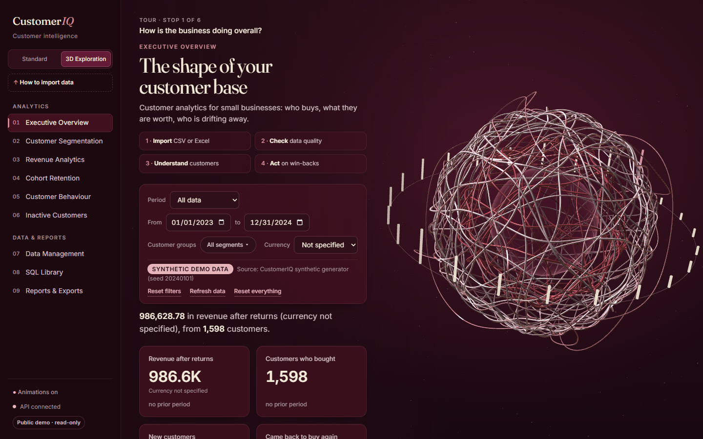 | 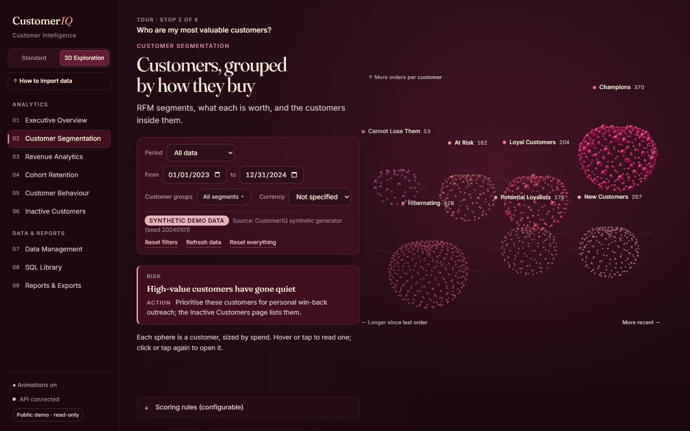 |
| 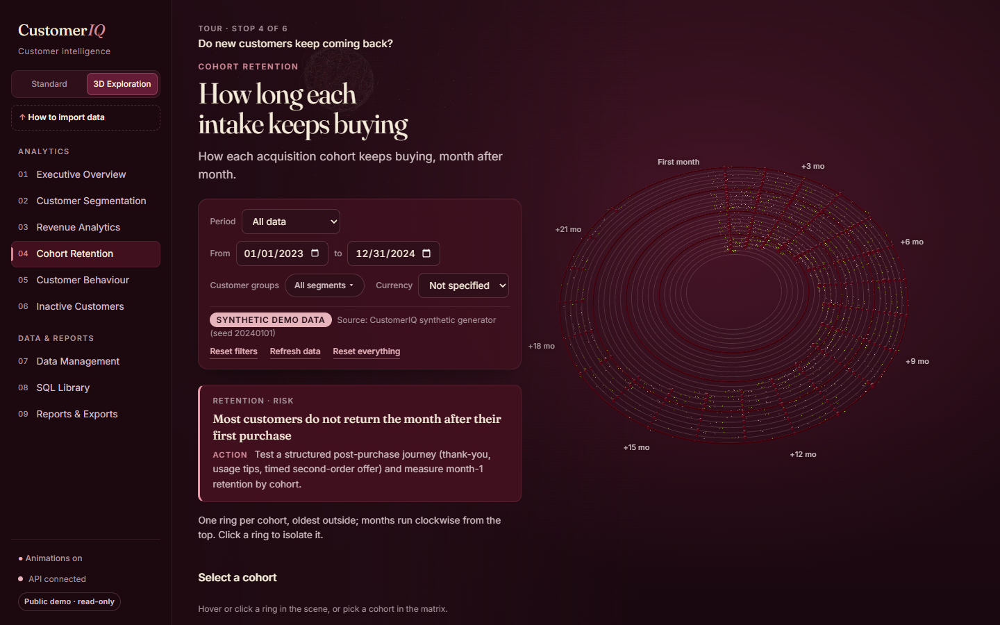 | 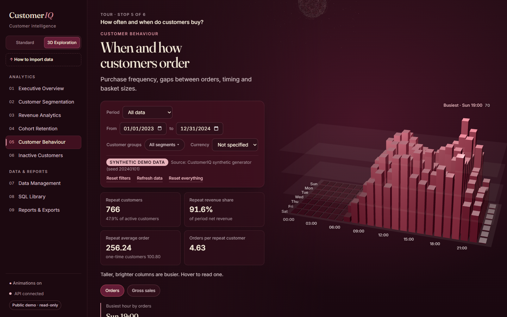 |

3D Exploration is a six-stop guided tour (three.js, loaded only when switched on; 2D fallback without WebGL).

## On a phone

| Phone · Standard | Phone · 3D | Import guide |
|---|---|---|
| 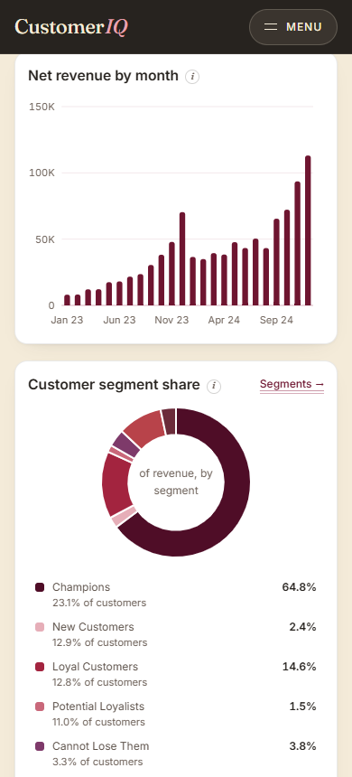 | 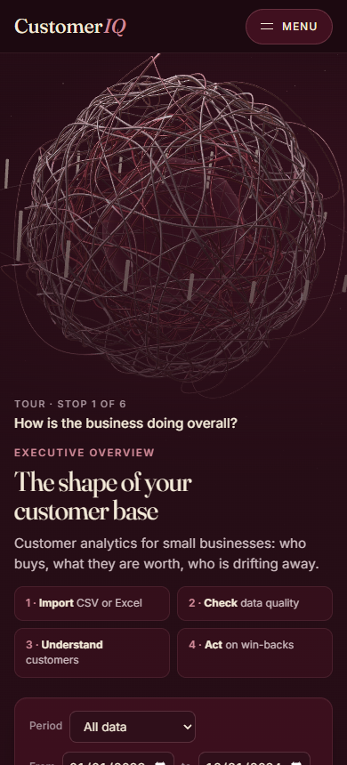 | 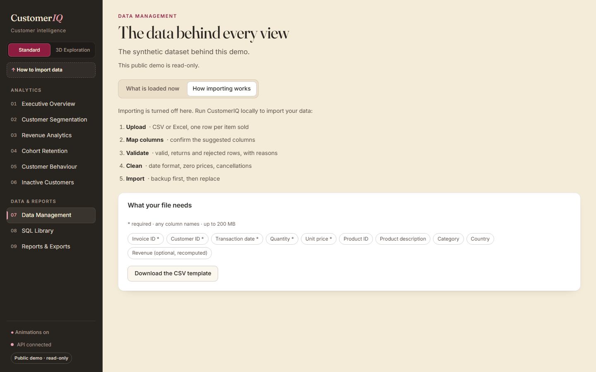 |

## Setup

Python 3.15 and Node.js 26 (Windows 11 tested).

```powershell
python -m venv .venv
.\.venv\Scripts\Activate.ps1
python -m pip install -r requirements.txt
cd web; npm install; npm run build; cd ..
```

## Run

```powershell
.\.venv\Scripts\python.exe -m src.api
```

Open the **single-use login link** it prints (valid 10 minutes; new one: `python -m src.api login-link`). On an empty database, load the demo or import a file in **Data Management**.

- **Dev (hot reload):** run the API, then `cd web; npm run dev` and paste the login link at <http://127.0.0.1:5173>.
- **Streamlit fallback:** `python -m streamlit run app.py --server.port 8517`
- **Data:** `data/customeriq.db`. Every import, demo load or clear first writes a verified copy to `backups\` (10 newest kept). To restore, stop the server and copy a backup over `data\customeriq.db`.

## Tests

```powershell
.\.venv\Scripts\python.exe -m pytest
cd web; npm run typecheck; npm run build; npm run test:e2e
```

Tests use temporary databases and never touch `data/customeriq.db`.

## Stack

Python · FastAPI · SQLite · Pandas · ReportLab · React · TypeScript · Vite · three.js. No paid services or API keys; runs locally on `127.0.0.1`.

## Docs

[Architecture](ARCHITECTURE.md) · [SQL guide](SQL_ANALYSIS_GUIDE.md) · [Data dictionary](DATA_DICTIONARY.md) · [Methodology](ANALYTICAL_METHODOLOGY.md) · [Contributing](CONTRIBUTING.md)

## License

MIT © 2026 Abia Iqbal. See [LICENSE](LICENSE).
