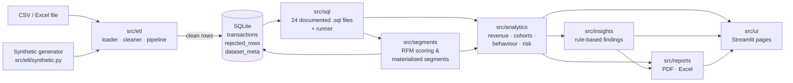
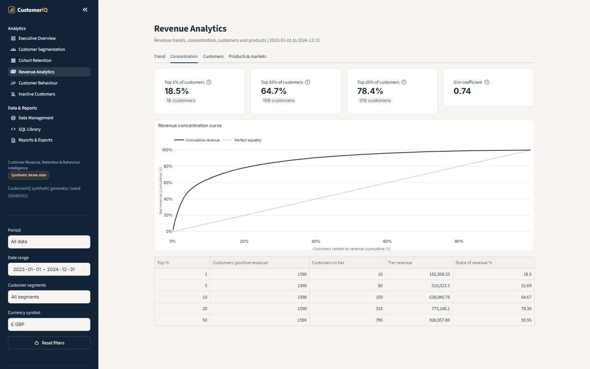
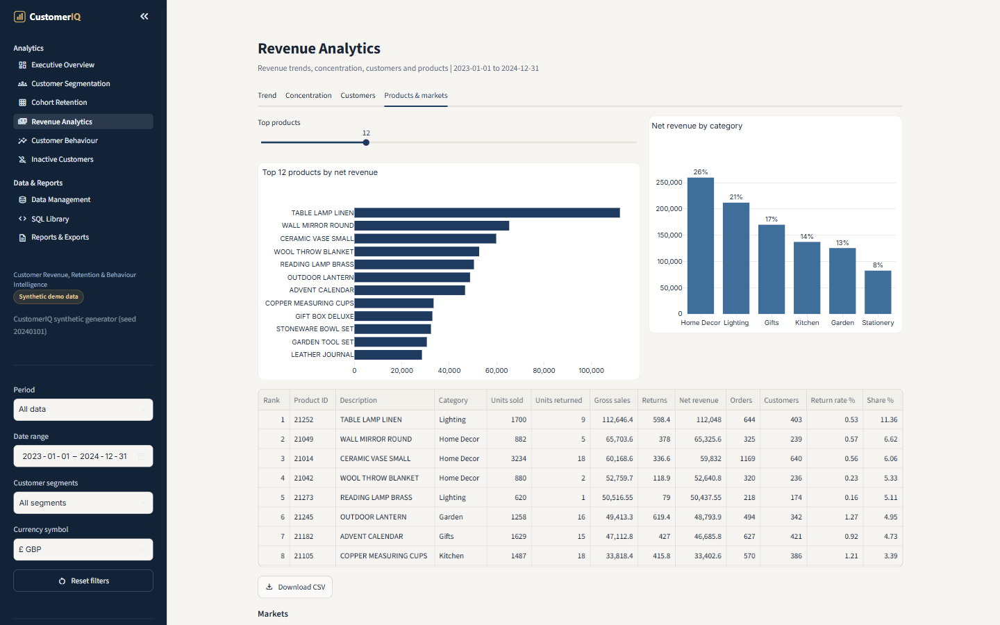
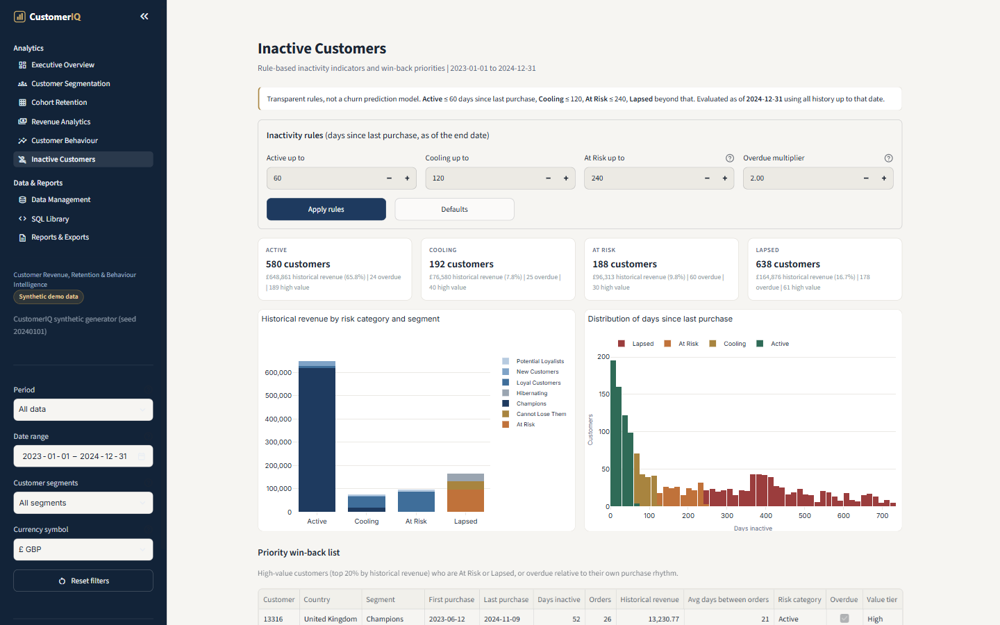
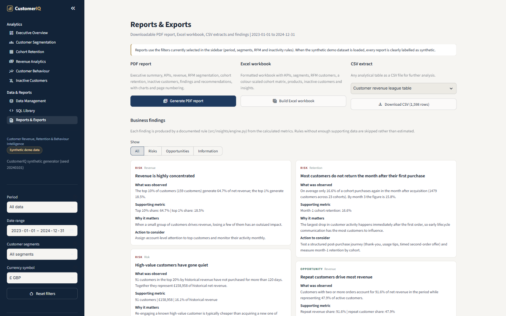

# CustomerIQ

**Customer Revenue, Retention & Behaviour Intelligence**

CustomerIQ is a customer analytics application for businesses that sell online. It turns transaction-level sales data into answers to six business questions:

1. Who are our most valuable customers?
2. Which customers are returning?
3. Which customers are becoming inactive?
4. Which customer segments generate the most revenue?
5. How does customer retention change over time?
6. Where are the revenue opportunities and risks?

The analysis runs in **SQL on SQLite** through 24 documented query files. Python handles data cleaning, orchestration, visualisation and reporting. A Streamlit dashboard and a PDF/Excel report generator sit on top.

> **Data notice.** The bundled demo dataset is **synthetic**. A deterministic generator produces it (seed `20240101`), and it does not describe real customers. All figures quoted in this README come from that synthetic data. The app labels synthetic data on every page and in every export. You can import your own CSV or Excel file at any time.


---

## Why this project matters

Most small and mid-sized online sellers have transaction exports but no customer view. They know revenue, but not *who* drives it, *who is drifting away* or *whether new customers come back*. CustomerIQ runs the analyses a customer analytics team would run (RFM segmentation, cohort retention, revenue concentration, inactivity monitoring) and keeps every rule transparent and every number traceable to a SQL query.

## Key features

| Area | What it does |
|---|---|
| **Data pipeline** | CSV and Excel import with automatic column mapping, preview, validation, duplicate detection, date parsing, customer-ID checks, separate handling of returns (negative quantities / `C` invoices) and an audit table of rejected rows with reasons. |
| **Executive Overview** | 8 KPIs (net revenue, orders, active customers, AOV, new customers, repeat rate, revenue per customer, return rate). Each KPI is compared with the previous equal-length period, alongside trend charts and the top rule-based findings. |
| **Customer Segmentation** | RFM scoring (quantile or fixed thresholds, configurable in the sidebar), 7 named segments, segment size and revenue share, R×F grid, a searchable customer table and a per-customer order drill-down. You can view the SQL that produced the segments. |
| **Cohort Retention** | Monthly acquisition cohorts, a retention heatmap (percent or customer counts), an average retention curve and month-over-month retention. |
| **Revenue Analytics** | Monthly trend with growth, Pareto curve and top-X% concentration, customer league table, product, category and country performance. |
| **Customer Behaviour** | Purchase frequency distribution, days between orders, order value bands, weekday × hour heatmap, new vs returning customers. |
| **Inactive Customers** | Rule-based Active / Cooling / At Risk / Lapsed categories, an "overdue" flag relative to each customer's own purchase rhythm, value tiers and a priority win-back list. Thresholds are configurable. |
| **SQL Library** | Browse all 24 analytical queries with their documentation, read the SQL and run any query with the current filters. Results download as CSV. |
| **Business insights** | 9 documented rules (8 produce a finding on the demo data). Each finding states what was observed, the supporting metric, why it matters and an action to consider. A rule is skipped when the data is too thin to support it. |
| **Reports & Exports** | Multi-page PDF report (ReportLab, with charts and page numbers), formatted Excel workbook and CSV extracts of any analytical table. |

Every page responds to the sidebar filters: period presets, date range, RFM segment and currency. The Executive Overview is the app's home page at `/` (Streamlit serves its default page at the root, so `/overview` also opens it but logs a harmless "page not found" console message; use `/`).

## Technology stack

Python · SQLite · SQL · Pandas · NumPy · Streamlit · Plotly · OpenPyXL · ReportLab · Pytest

No paid services, API keys or external network calls are needed.

## Architecture



See [ARCHITECTURE.md](ARCHITECTURE.md) for module responsibilities and the request flow.

## Installation

Developed and tested on Windows 11 with Python 3.15.2.

```powershell
cd "C:\path\to\Customer IQ"
python -m venv .venv
.\.venv\Scripts\Activate.ps1
python -m pip install -r requirements.txt
```

## How to run

```powershell
.\.venv\Scripts\python.exe -m streamlit run app.py --server.port 8517
```

Then open <http://localhost:8517>. On the first launch, the synthetic demo dataset is generated and loaded automatically. To analyse your own data, go to **Data Management → Import file**, upload a CSV or Excel file, check the suggested column mapping and validation preview, then import it.

Run the tests:

```powershell
.\.venv\Scripts\python.exe -m pytest
```

Optionally, regenerate the small synthetic CSV/Excel files used to try the import flow:

```powershell
.\.venv\Scripts\python.exe scripts\generate_sample_files.py
```

### Importing your own data

Required columns are invoice ID, customer ID, transaction date, quantity and unit price. Optional columns are product ID, description, category, country and revenue (revenue is always recomputed as quantity × unit price). Common header names are mapped automatically, including those of the public UCI *Online Retail* and *Online Retail II* datasets. See [DATA_DICTIONARY.md](DATA_DICTIONARY.md).

## Example findings (synthetic demo data)

These are the outputs of CustomerIQ's rules applied to the **synthetic** dataset for 2023-01-01 to 2024-12-31 (1,598 customers, 4,379 orders, 986,629 net revenue in the dataset's own currency units). They show what the engine produces. They are not claims about any real business.

- **Revenue is concentrated.** The top 10% of customers generate 64.7% of net revenue, and the top 1% generate 18.5%.
- **Repeat customers drive revenue.** Customers with two or more orders are 47.9% of customers but generate 91.6% of net revenue.
- **Champions dominate.** The Champions RFM segment holds 23.2% of customers and 64.8% of net revenue, with an average order value of 292 against 227 overall.
- **Early retention is the main leak.** On average only 16.6% of a cohort buys again in the month after acquisition.
- **High-value customers have gone quiet.** 91 customers in the top 20% by historical revenue have not purchased for more than 120 days. They account for 158,958 (16.1%) of historical revenue.
- **Second orders follow quickly when they happen.** The median time to a second order is 54 days.
- **Data quality.** The cleaning pipeline rejected 138 of 13,792 raw rows: 60 missing customer IDs, 45 exact duplicates, 15 zero prices, 10 zero quantities and 8 unparseable dates. It also kept 147 return lines as returns.

## SQL techniques demonstrated

All in [`src/sql/queries/`](src/sql/queries), each file with a documented header (purpose, parameters, output, techniques):

- CTEs, including `MATERIALIZED` CTEs and multi-stage pipelines
- Joins: INNER, LEFT, self-joins on month offsets, CROSS JOIN
- `GROUP BY` / `HAVING`, conditional aggregation with `CASE`
- Window functions: `ROW_NUMBER`, `RANK`, `DENSE_RANK`, `PERCENT_RANK`, `LAG`, running `SUM() OVER` with explicit frames, named `WINDOW`
- Subqueries: scalar, correlated, `IN`, and JSON-array filters via `json_each`
- Date arithmetic with `julianday()` and `strftime()`, and an integer month number for cohort offsets
- `VALUES` dimension tables, so empty buckets still appear
- Parameter binding for every user value, with a small macro system so every query applies the same date and segment filters

[SQL_ANALYSIS_GUIDE.md](SQL_ANALYSIS_GUIDE.md) walks through each query.

## Screenshots

All screenshots show the running application with the synthetic demo dataset.

| | |
|---|---|
| **Executive Overview**<br> | **Customer Segmentation (RFM)**<br> |
| **Cohort Retention**<br> | **Revenue Analytics: Trend**<br> |
| **Revenue Concentration**<br> | **Products & Markets**<br> |
| **Customer Behaviour**<br> | **Inactive Customers**<br> |
| **Data Management**<br> | **SQL Library**<br> |
| **Reports & Exports**<br> | |

## Testing

107 automated tests (`pytest`), all passing:

| File | Tests | Covers |
|---|---|---|
| `test_cleaning.py` | 22 | Duplicates, missing/invalid customer IDs, invalid dates, negative quantities and returns, zero prices, invoice–customer conflicts |
| `test_rfm.py` | 21 | Quantile and fixed scoring, tie handling, segment rules, configuration validation |
| `test_sql_revenue.py` | 20 | KPIs, period comparison, monthly revenue, concentration, Pareto, products, categories, countries, repeat purchase |
| `test_etl_import.py` | 12 | CSV/Excel reading (delimiters, BOM, Latin-1), UCI column auto-mapping, atomic import into SQLite, empty files |
| `test_insights_reports.py` | 12 | Insight rules, PDF generation (normal, empty period, empty database), Excel workbook |
| `test_cohorts.py` | 9 | Cohort assignment, retention percentages, matrix shape, month-over-month retention |
| `test_risk.py` | 8 | Inactivity categories, overdue flag, value tiers, threshold validation |
| `test_sql_library.py` | 3 | Every documented query runs with dashboard parameters |

SQL results are checked against a small hand-calculated dataset (documented in `tests/conftest.py`), so expected values are computed independently of the code under test.

## Limitations

- **Rule-based, not predictive.** Inactivity categories and segments are transparent rules. They are not machine-learning churn predictions, because there is no labelled churn data to train or evaluate a model.
- **RFM segments are descriptive.** They are a common business heuristic, not scientifically validated customer classes.
- **One dataset at a time.** Importing a file replaces the current dataset. There is no multi-tenant or multi-store support.
- **Currency is not detected.** Transaction files do not say which currency they use, so amounts are shown as plain numbers labelled "Currency not specified" until you pick a currency in the sidebar. The choice only adds a symbol; nothing is converted. The PDF and Excel exports state the same setting.
- **Animations.** The five section animations in `assets/animations` are never modified. On start, CustomerIQ writes streamable copies to `static/animations` (a lossless remux that moves the MP4 index to the front so playback starts quickly). Fonts are served locally from `static/fonts` (SIL Open Font License).
- **SQLite scale.** This suits datasets up to roughly a few million rows on a laptop. Larger volumes would need a warehouse engine.
- **Categories are optional.** Category analysis shows "Uncategorised" when the source file has no category column.
- **Deep-link console messages.** Opening a page directly by URL (for example `/inactive`) logs two `404` messages in the browser console. Streamlit's frontend first probes `/<page>/_stcore/health` and `/<page>/_stcore/host-config` before falling back to the root endpoints. This is framework behaviour and does not affect the app. Navigating within the app produces no console errors.

## Future improvements

- Customer lifetime value projection, with honest validation on hold-out periods
- Product affinity / market-basket analysis
- Scheduled report generation and email delivery
- Pluggable database backend (PostgreSQL / DuckDB) for larger datasets
- Multiple datasets with side-by-side comparison

## Documentation

- [ARCHITECTURE.md](ARCHITECTURE.md): modules, data flow and design decisions
- [SQL_ANALYSIS_GUIDE.md](SQL_ANALYSIS_GUIDE.md): every query explained
- [DATA_DICTIONARY.md](DATA_DICTIONARY.md): import fields, database tables and derived metrics
- [ANALYTICAL_METHODOLOGY.md](ANALYTICAL_METHODOLOGY.md): metric definitions, RFM, cohorts, risk rules and insight rules
- [CONTRIBUTING.md](CONTRIBUTING.md): development workflow

## License

MIT © 2026 Abia Iqbal. See [LICENSE](LICENSE).

## Local API (optional)

A token-protected JSON API over the same analytics and database, for a separate frontend.
It is local-only: it binds to `127.0.0.1`, accepts only `127.0.0.1`/`localhost` Host headers and
never contacts external services. The Streamlit app is unaffected and still runs on port 8517.

```powershell
.\.venv\Scripts\python.exe -m src.api --port 8520
```

Every route except `GET /api/health` needs `Authorization: Bearer <token>`. The token is read from
`CUSTOMERIQ_API_TOKEN`, or generated once into `.customeriq_token` (git-ignored). Imports, demo
loads and clears require `"confirm": true` and first take a verified backup into `backups/`.
