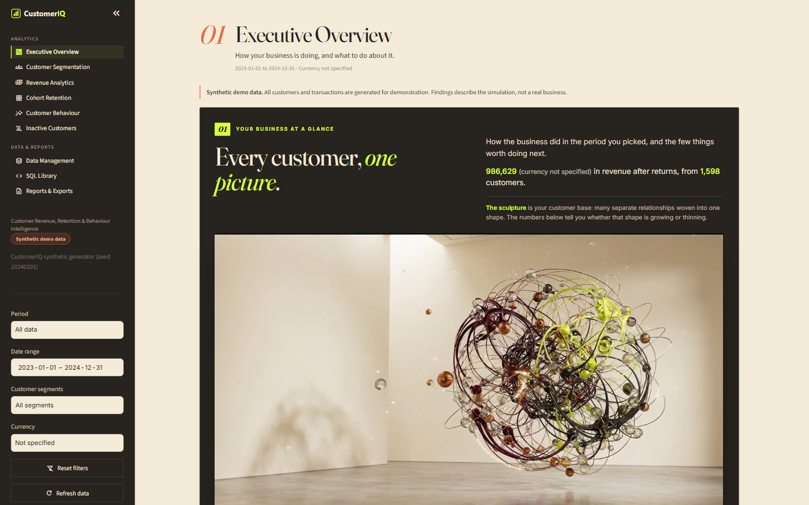
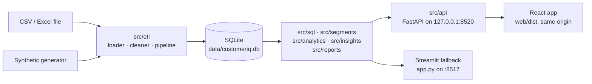
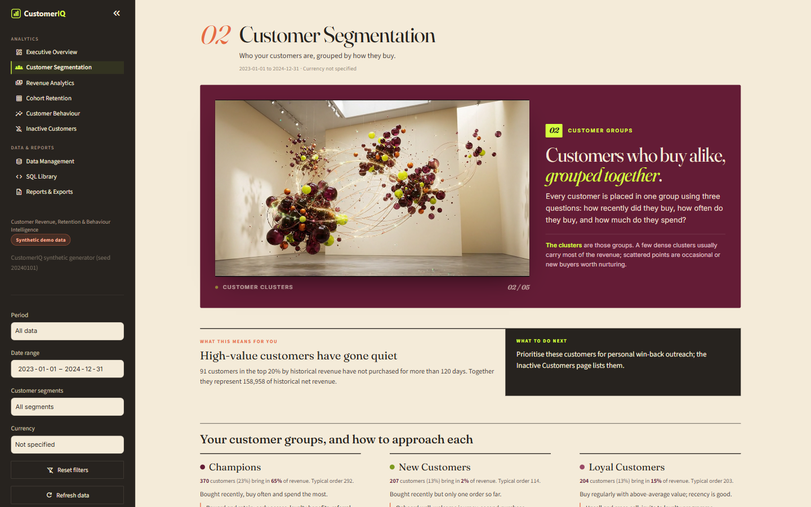
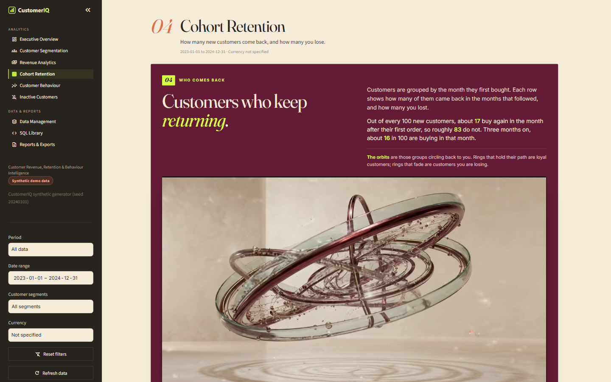
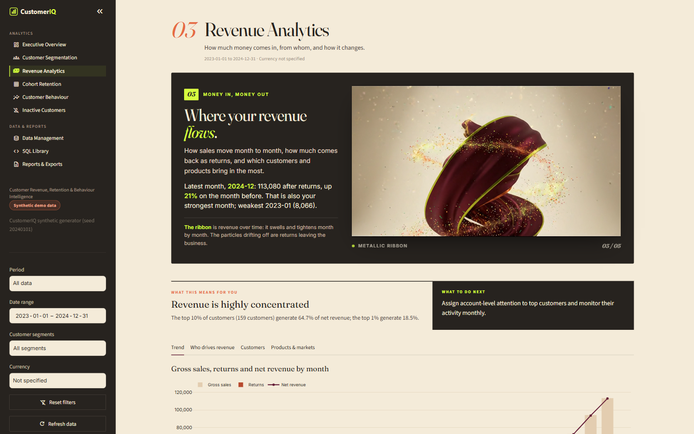
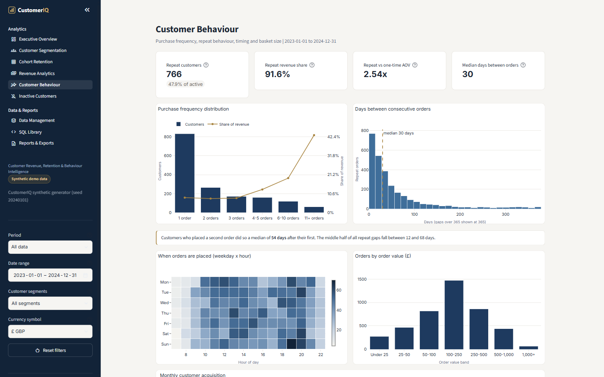
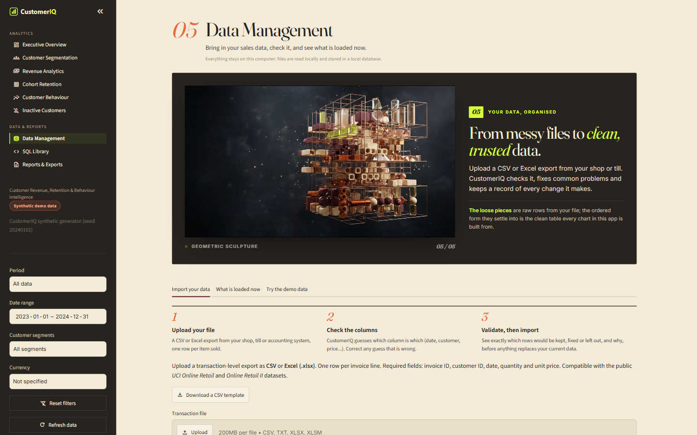
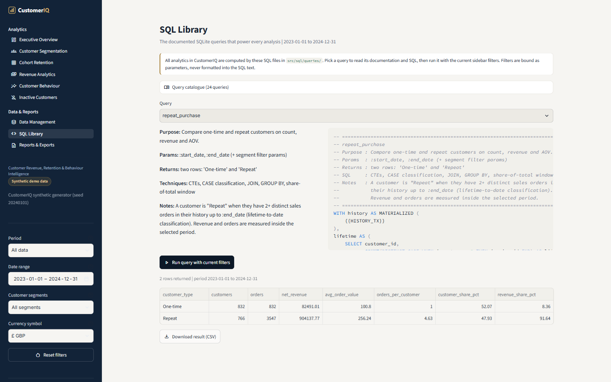

# CustomerIQ

**Customer Revenue, Retention & Behaviour Intelligence**

CustomerIQ is a customer analytics application for businesses that sell online. It turns transaction-level sales data into answers to six business questions:

1. Who are our most valuable customers?
2. Which customers are returning?
3. Which customers are becoming inactive?
4. Which customer segments generate the most revenue?
5. How does customer retention change over time?
6. Where are the revenue opportunities and risks?

The analysis runs in **SQL on SQLite** through 24 documented query files. Python handles data cleaning, orchestration and reporting. The main interface is a **React web app served by a local FastAPI server**. The original **Streamlit dashboard** is kept as a fallback, and both use the same analytics code and database.

> **Data notice.** The bundled demo dataset is **synthetic**. A deterministic generator produces it (seed `20240101`), and it does not describe real customers. All figures quoted in this README come from that synthetic data. The app labels synthetic data on every page and in every export. You can import your own CSV or Excel file at any time.



*Executive Overview in the Streamlit fallback, with synthetic demo data. The primary interface is the React web app.*

---

## Why this project matters

Most small and mid-sized online sellers have transaction exports but no customer view. They know revenue, but not *who* drives it, *who is drifting away* or *whether new customers come back*. CustomerIQ runs the analyses a customer analytics team would run (RFM segmentation, cohort retention, revenue concentration, inactivity monitoring) and keeps every rule transparent and every number traceable to a SQL query.

## Key features

| Area | What it does |
|---|---|
| **Data pipeline** | CSV and Excel import with automatic column mapping, preview, validation, duplicate detection, date parsing, customer-ID checks, separate handling of returns (negative quantities / `C` invoices) and an audit table of rejected rows with reasons. |
| **Executive Overview** | 8 KPIs (net revenue, orders, active customers, AOV, new customers, repeat rate, revenue per customer, return rate). Each KPI is compared with the previous equal-length period, alongside trend charts and the top rule-based findings. |
| **Customer Segmentation** | RFM scoring (quantile or fixed thresholds, configurable), 7 named segments, segment size and revenue share, R×F grid, a searchable customer table and a per-customer order drill-down. |
| **Cohort Retention** | Monthly acquisition cohorts, a retention heatmap (percent or customer counts), an average retention curve and month-over-month retention. |
| **Revenue Analytics** | Monthly trend with growth, Pareto curve and top-X% concentration, customer league table, product, category and country performance. |
| **Customer Behaviour** | Purchase frequency distribution, days between orders, order value bands, weekday × hour heatmap, new vs returning customers. |
| **Inactive Customers** | Rule-based Active / Cooling / At Risk / Lapsed categories, an "overdue" flag relative to each customer's own purchase rhythm, value tiers and a priority win-back list. Thresholds are configurable. |
| **SQL Library** | Browse all 24 analytical queries and run any of them with the current filters. Results download as CSV. |
| **Business insights** | 9 documented rules (8 produce a finding on the demo data). Each finding states what was observed, the supporting metric, why it matters and an action to consider. A rule is skipped when the data is too thin to support it. |
| **Reports & Exports** | Multi-page PDF report (ReportLab, with charts and page numbers), formatted Excel workbook and formula-safe CSV extracts of analytical tables. |

Every analytical page shares one filter bar: period presets, date range, RFM segment and currency.

The web app has two view modes, switched in the sidebar. **Standard** (the default) uses 2D SVG charts. **3D Exploration** adds a three.js scene per page and is only downloaded when you turn it on (`?3d` in the URL also turns it on).

## Technology stack

- **Backend:** Python · FastAPI · Uvicorn · SQLite · SQL · Pandas · NumPy · OpenPyXL · ReportLab
- **Web app:** React · TypeScript · Vite · React Router · three.js / React Three Fiber (3D mode only)
- **Fallback UI:** Streamlit · Plotly
- **Tests:** Pytest

No paid services, API keys or external network calls are needed. Everything runs on `127.0.0.1`.

## Architecture



See [ARCHITECTURE.md](ARCHITECTURE.md) for module responsibilities, the request flow and the security model.

## Installation

Requires Python 3.15 and Node.js 26 (the versions it is developed and tested with, on Windows 11; older versions are untested).

```powershell
cd "C:\path\to\Customer IQ"
python -m venv .venv
.\.venv\Scripts\Activate.ps1
python -m pip install -r requirements.txt

cd web
npm install
npm run build      # type-checks, then writes web\dist
cd ..
```

## How to run

### Web app (recommended)

```powershell
.\.venv\Scripts\python.exe -m src.api
```

The server prints the app address (`http://127.0.0.1:8520/`) and a **single-use login link**. Open the link in your browser: it signs you in and takes you to the app. Use `--port <n>` to pick another port.

If `web\dist` has not been built, the server says so and serves the API only.

The API does not load demo data by itself. On an empty database, open **Data Management** and load the demo dataset or import a file.

### Signing in

- The login link is valid for 10 minutes and works once. For a new one while the server is running:
  `.\.venv\Scripts\python.exe -m src.api login-link` (add `--port <n>` if you changed it).
- You can also paste the link into the sign-in box the app shows when you are signed out.
- A browser session lasts 12 hours. Restarting the server ends all sessions.

### Development (hot reload)

Run the API and the Vite dev server side by side:

```powershell
# terminal 1
.\.venv\Scripts\python.exe -m src.api
# terminal 2
cd web
npm run dev        # http://127.0.0.1:5173, proxies /api to 127.0.0.1:8520
```

Paste the API's login link into the sign-in box on the Vite page. If port 5173 is taken, choose another port for both servers (Vite will not move to a different port by itself):

```powershell
.\.venv\Scripts\python.exe -m src.api --web-port 5180
cd web; $env:CIQ_WEB_PORT=5180; npm run dev
```

If the API is not on 8520, also set `$env:CIQ_API_PORT` to its port before `npm run dev`.

### Streamlit fallback

```powershell
.\.venv\Scripts\python.exe -m streamlit run app.py --server.port 8517
```

Open <http://localhost:8517>. On its first launch it generates and loads the synthetic demo dataset. It reads and writes the same `data/customeriq.db`. Port 8517 is reserved for it; the API refuses to start there.

## Data, imports and backups

- **Database:** `data/customeriq.db` (set `CUSTOMERIQ_DB` to use another file). It is git-ignored.
- **Importing:** in **Data Management**, upload a CSV or Excel file, check the suggested column mapping and the validation preview, then confirm. Required columns are invoice ID, customer ID, transaction date, quantity and unit price. Optional columns are product ID, description, category, country and revenue (revenue is always recomputed as quantity × unit price). Common header names are mapped automatically, including those of the public UCI *Online Retail* and *Online Retail II* datasets. See [DATA_DICTIONARY.md](DATA_DICTIONARY.md).
- **One dataset at a time:** importing, loading the demo or clearing replaces the current dataset. A failed or empty import keeps the previous one.
- **Automatic backups:** before every import, demo load or clear, the API copies the database to `backups\auto-customeriq-<timestamp>.db`. The copy must pass `PRAGMA integrity_check` and match every table's row count, or the change is refused. The 10 newest `auto-` backups are kept; other files in `backups\` are never deleted. The Streamlit fallback does **not** take these backups.
- **Restoring a backup:** stop the API and Streamlit. Move `data\customeriq.db` (plus any `customeriq.db-wal` and `customeriq.db-shm` beside it) somewhere safe, then copy the backup file to `data\customeriq.db`.

To regenerate the small synthetic CSV/Excel files used to try the import flow:

```powershell
.\.venv\Scripts\python.exe scripts\generate_sample_files.py
```

## SQL library and reports

- **SQL Library** lists the 24 documented queries in [`src/sql/queries/`](src/sql/queries) and runs them with the current filters. Only those files can run; there is no free-text SQL. Library queries run read-only, and the API returns at most 5,000 rows per run.
- **Reports & Exports** downloads the PDF report, the Excel workbook and CSV extracts. CSV and Excel cells that start with a formula character are escaped, so a spreadsheet will not run them.

## Example findings (synthetic demo data)

These are the outputs of CustomerIQ's rules applied to the **synthetic** dataset for 2023-01-01 to 2024-12-31 (1,598 customers, 4,379 orders, 986,629 net revenue in the dataset's own currency units). They show what the engine produces. They are not claims about any real business.

- **Revenue is concentrated.** The top 10% of customers generate 64.7% of net revenue, and the top 1% generate 18.5%.
- **Repeat customers drive revenue.** Customers with two or more orders are 47.9% of customers but generate 91.6% of net revenue.
- **Champions dominate.** The Champions RFM segment holds 23.2% of customers and 64.8% of net revenue, with an average order value of 292 against 227 overall.
- **Early retention is the main leak.** On average only 16.6% of a cohort buys again in the month after acquisition.
- **High-value customers have gone quiet.** 91 customers in the top 20% by historical revenue have not purchased for more than 120 days. They account for 158,958 (16.1%) of historical revenue.
- **Second orders follow quickly when they happen.** The median time to a second order is 54 days.
- **Data quality.** The cleaning pipeline rejected 138 of 13,792 raw rows: 60 missing customer IDs, 45 exact duplicates, 15 zero prices, 10 zero quantities and 8 unparseable dates. It also kept 147 return lines as returns.

## SQL techniques demonstrated

All in [`src/sql/queries/`](src/sql/queries), each file with a documented header (purpose, parameters, output, techniques):

- CTEs, including `MATERIALIZED` CTEs and multi-stage pipelines
- Joins: INNER, LEFT, self-joins on month offsets, CROSS JOIN
- `GROUP BY` / `HAVING`, conditional aggregation with `CASE`
- Window functions: `ROW_NUMBER`, `RANK`, `DENSE_RANK`, `PERCENT_RANK`, `LAG`, running `SUM() OVER` with explicit frames, named `WINDOW`
- Subqueries: scalar, correlated, `IN`, and JSON-array filters via `json_each`
- Date arithmetic with `julianday()` and `strftime()`, and an integer month number for cohort offsets
- `VALUES` dimension tables, so empty buckets still appear
- Parameter binding for every user value, with a small macro system so every query applies the same date and segment filters

[SQL_ANALYSIS_GUIDE.md](SQL_ANALYSIS_GUIDE.md) walks through each query.

## Screenshots

These screenshots show the **Streamlit fallback** with the synthetic demo dataset.

| | |
|---|---|
| **Executive Overview**<br> | **Customer Segmentation (RFM)**<br> |
| **Cohort Retention**<br> | **Revenue Analytics: Trend**<br> |
| **Revenue Concentration**<br> | **Products & Markets**<br> |
| **Customer Behaviour**<br> | **Inactive Customers**<br> |
| **Data Management**<br> | **SQL Library**<br> |
| **Reports & Exports**<br> | |

## Testing

```powershell
.\.venv\Scripts\python.exe -m pytest      # 288 tests
cd web; npm run typecheck; cd ..          # TypeScript check of the web app
```

Browser (end-to-end) tests run the built app in Chromium against two throwaway servers with their own temporary synthetic databases:

```powershell
cd web
npm run build
npx playwright install chromium   # first time only
npm run test:e2e                  # 74 tests plus a sign-in setup step; about 5-10 minutes
cd ..
```

They cover sign-in, single-use links, session expiry, CSRF and Origin checks, every page in both view modes (direct load, refresh, back/forward, phone to desktop widths), the 3D scenes, SQL Library, downloads, and import, demo load and clear with their backups. The run fails if `data/customeriq.db` or `backups\` changes.

The tests never touch `data/customeriq.db`; they use temporary databases. They cover cleaning, RFM, SQL results, cohorts, risk, insights, PDF and Excel reports, import, the SQL library, and the API (sessions, CSRF, Host and Origin checks, backups before writes, the served web app and its JSON 404s). SQL results are checked against a small hand-calculated dataset (documented in `tests/conftest.py`), so expected values are computed independently of the code under test.

## Troubleshooting

| Symptom | Cause and fix |
|---|---|
| Server prints "Web app not built" | Run `npm run build` in `web\`, then restart the server. |
| "Login link is invalid, expired or already used" | Links work once and expire after 10 minutes. Get a new one with `.\.venv\Scripts\python.exe -m src.api login-link`. |
| The app asks you to sign in again | The session expired (12 hours) or the server restarted. Use a new login link. |
| `npm run dev` stops with "Port 5173 … is not available" | Something else uses the port. Pick a free one for both servers (see *Development*). |
| The dev app reports that the API is not reachable | Start `.\.venv\Scripts\python.exe -m src.api`, and check that `CIQ_API_PORT` matches its port. |
| Changes fail from the dev app, but reading works | The API's `--web-port` must equal the Vite port (`CIQ_WEB_PORT`). |
| HTTP 400 on every request | Open the app as `127.0.0.1` or `localhost`. Other host names are refused. |
| "Could not create a verified backup; the dataset was not changed" | Check free disk space and that `backups\` is writable, then try again. |
| "The CustomerIQ API took too long to respond" | The request ran longer than 60 seconds, which happens with very large datasets (see *Limitations*). The server finishes the work and keeps the result, so retry after a minute or two. |
| Pages say "No dataset is loaded yet" | Load the demo dataset or import a file in **Data Management**. |

## Limitations

- **Rule-based, not predictive.** Inactivity categories and segments are transparent rules. They are not machine-learning churn predictions, because there is no labelled churn data to train or evaluate a model.
- **RFM segments are descriptive.** They are a common business heuristic, not scientifically validated customer classes.
- **One dataset at a time.** There is no multi-tenant or multi-store support.
- **Local, single user.** The server only listens on `127.0.0.1`. It is not designed to be exposed on a network.
- **Currency is not detected.** Transaction files do not say which currency they use, so amounts are shown as plain numbers labelled "Currency not specified" until you pick a currency. The choice only adds a symbol; nothing is converted. The PDF and Excel exports state the same setting.
- **SQLite scale.** This suits datasets up to roughly a few million rows on a laptop. Larger volumes would need a warehouse engine.
- **Business insights are slow on very large datasets.** On about one million transaction lines the insights panel on Executive Overview took about 121 seconds to compute in testing. The browser stops waiting after 60 seconds and offers *Retry*. The server finishes the calculation and caches it, so a retry after that returns at once. The rest of the page loads independently.
- **Categories are optional.** Category analysis shows "Uncategorised" when the source file has no category column.
- **Streamlit fallback notes.** The five section animations in `assets/animations` are never modified; on start, Streamlit writes streamable copies to `static/animations`. Fonts are served locally from `static/fonts` (SIL Open Font License). Opening a Streamlit page directly by URL (for example `/inactive`) logs two harmless `404` messages in the browser console; this is framework behaviour.

## Future improvements

- Customer lifetime value projection, with honest validation on hold-out periods
- Product affinity / market-basket analysis
- Scheduled report generation and email delivery
- Pluggable database backend (PostgreSQL / DuckDB) for larger datasets
- Multiple datasets with side-by-side comparison

## Documentation

- [ARCHITECTURE.md](ARCHITECTURE.md): modules, data flow, security model and design decisions
- [SQL_ANALYSIS_GUIDE.md](SQL_ANALYSIS_GUIDE.md): every query explained
- [DATA_DICTIONARY.md](DATA_DICTIONARY.md): import fields, database tables and derived metrics
- [ANALYTICAL_METHODOLOGY.md](ANALYTICAL_METHODOLOGY.md): metric definitions, RFM, cohorts, risk rules and insight rules
- [CONTRIBUTING.md](CONTRIBUTING.md): development workflow

## License

MIT © 2026 Abia Iqbal. See [LICENSE](LICENSE).
